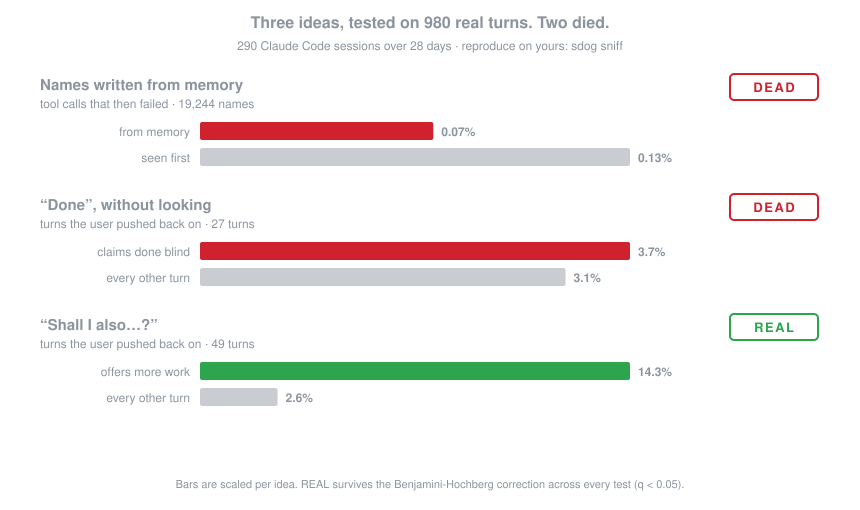
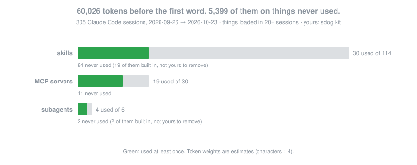

<p align="center">
  <picture>
    <source media="(prefers-color-scheme: dark)" srcset="assets/logo-dark.png">
    
  </picture>
</p>

<h1 align="center">SuspiciousDog</h1>

<p align="center"><b>Non si fida dei tuoi plugin. Ha letto i tuoi transcript.</b></p>

<p align="center"><a href="README.md">English</a></p>

<p align="center">
  
</p>

Ogni plugin, skill, hook e riga di `CLAUDE.md` o `AGENTS.md` che dai a un agente AI è un'ipotesi: *se l'agente fa X,
lavoro meglio.* Nessuno la verifica. La installi perché suona bene.

Intanto il tuo agente ha preso appunti. Ogni turno di ogni sessione è sul disco, insieme a quello che hai risposto
subito dopo. L'esperimento è già fatto. SuspiciousDog lo legge.

## Lo conosci

Sta nell'angolo. Non dice niente quando installi il plugin di cui parlano tutti. Due settimane dopo si avvicina con
un foglio stampato: non è cambiato niente. Aveva ragione. Ha sempre ragione. Ha letto i log.

## I numeri

Il 23/10 lo abbiamo provato sulle nostre sessioni: 290 sessioni di Claude Code, 980 turni, 28 giorni. Una persona, un
modello. Dati veri, gli stessi conteggi che chiunque può rifare con `sdog sniff`. Gli abbiamo dato le nostre tre
idee migliori.

**Nomi scritti a memoria: morta.** Se un agente scrive un metodo, un flag o una colonna che non ha mai visto nel
contesto, lo prende dalla memoria del modello: lì nascono le allucinazioni, pensavamo. Su 90.101 nomi, i 19.244
scritti a memoria hanno fatto fallire uno strumento nello 0,07% dei casi. Quelli visti prima, nello 0,13%.

**"Fatto", senza guardare: morta.** L'agente dice di aver finito senza aver eseguito, aperto o visualizzato niente
dopo l'ultima modifica. È successo in 27 turni. Risposte negative dopo: 3,7%, contro 3,1% negli altri turni.

**"Faccio anche…?": vera.** L'agente chiude il turno offrendo altro lavoro. La risposta è negativa nel 14,3% dei casi,
contro il 2,6% (q = 0,045). `sdog show` spiega perché: non è rabbia, è *"no, mettila tra le cose da fare in
futuro"*. Gli stessi turni finiscono in un rinvio nel 10,2% dei casi contro l'1,4%, appena sotto la soglia.

Due idee su tre sono morte in una sera. Senza misurare le avremmo installate come hook su tutti i nostri progetti.
Quella sopravvissuta ce l'ha fatta per un soffio.

**Il giorno dopo non più.** Il 24/10 sono arrivate altre tre proposte, nessuna rifiutata: 7 su 52, q = 0,065. Torna
"forse". L'esito "lamentela" aggiunto nella 0.2 lo conferma: su 52 proposte, zero lamentele. Alle proposte si risponde
"dopo", non "sbagliato". Il soffio di una persona sola non è un risultato.

**Poi le risposte le ha lette un modello.** Le espressioni che riconoscono un "no" costano poco ma sono un po'
ottuse: per loro *"no, dopo"* è una lamentela. Nella 0.2 le risposte può leggerle un modello piccolo (`sdog classify`,
spento finché non lo lanci tu). Su 80 risposte etichettate a mano ne ha indovinate 77, le espressioni 58. Lette da
Haiku, le proposte di altro lavoro non sono affatto una cattiva abitudine: ricevono un sì rapido nel 40% dei casi
contro il 23%, e un no secco nel 7,7% contro l'1,4%. Chiudere con una domanda fa lo stesso, in modo più netto: sì nel
43% contro il 22%, no nel 6,7% contro l'1,1%, entrambi veri. Alle domande si risponde, tutto qui. La nostra idea
sopravvissuta era un "no" letto male.

Tre idee, tre sbagliate. È una persona sola, e per effetti così piccoli ne servono molte di più. **Qui entri tu.**

## Aiuta il branco

```bash
sdog share
```

Ti mostra tutto quello che invierebbe e aspetta il tuo sì. Poi apre una issue su GitHub, a tuo nome, con questo e
solo questo:

| Inviato | Mai inviato |
|---|---|
| quali agenti, quante sessioni | i tuoi prompt, le risposte dell'agente |
| quanti turni, in quanti giorni | nomi di file, percorsi, nomi dei progetti |
| per ogni fattore × esito: quattro numeri interi | codice, comandi, qualsiasi cosa tu abbia scritto |
| per plugin, server MCP e strumenti pubblici: sessioni in cui sono caricati e usati, chiamate, errori, peso | le tue skill, i plugin privati, i connettori con nomi tuoi, i CLAUDE.md: diventano un numero solo, "aggiunte private" |

I nomi dei fattori vengono dall'elenco di SuspiciousDog, quelli pubblici da elenchi fissi, e un test blocca la build
se potesse entrare altro ([PRIVACY.md](PRIVACY.md)). Ogni risultato condiviso è pubblico: il dataset è di tutti quelli
che lo arricchiscono. Una GitHub Action somma le condivisioni nella pagina del branco, che va online con le prime:
quali abitudini degli agenti vanno con risposte peggiori, e per ogni plugin e server MCP pubblico quanto lo usa
davvero chi lo carica e quanto spesso fallisce. I marketplace mostrano le stelle. Questa mostra l'uso.

## Il tuo kit

*Novità della 0.2.* Ogni plugin, skill, server MCP e riga del CLAUDE.md che aggiungi è una scommessa. Lui controlla
le scommesse. Claude Code registra quasi tutto; Codex, Gemini CLI e Aider meno, e `sdog doctor` dice cosa non si vede.

Ogni sessione annota cosa ha caricato nel contesto prima che tu scrivessi una parola (l'elenco delle skill e dei
sottoagenti, le istruzioni dei server MCP, i CLAUDE.md) e cosa ha usato davvero.
- `sdog` mostra il referto in una schermata.
- `sdog kit` mette in fila tutto: per ogni aggiunta dice quanto pesa, quante volte la usi, quante volte fallisce, e
  dà un verdetto.
- `sdog kit NOME` mostra il dettaglio, perché fallisce e come toglierla.

<p align="center"></p>

Sulle nostre 305 sessioni: 60.000 token prima della prima parola. Delle 114 skill caricate in almeno 20 sessioni ne
sono state usate 30, e circa 5.400 token a sessione andavano a cose mai usate.

`sdog prune` propone cosa togliere e lo fa solo dopo il tuo sì:
- disattiva i plugin e rimuove i server con i comandi dell'agente;
- sposta le skill in una soffitta, o nell'unico progetto che le usa;
- lascia stare le cose che usi ogni tanto e pesano meno di 100 token a sessione.

Ogni modifica finisce in un diario e si annulla con `sdog undo`. Quello che vive su claude.ai lo togli tu, e
`sdog note` lo annota. Dopo due settimane `sdog journal` dice se è peggiorato qualcosa e di quanto si è davvero
alleggerito l'inizio delle sessioni, misurato sull'uso delle API e non stimato.

Altri comandi:
- `sdog timeline` trova da solo i giorni in cui il kit è cambiato e confronta le tue risposte nei 14 giorni prima e
  dopo.
- `sdog rules` (beta) cerca le regole che le tue correzioni continuano a ripetere.
- `sdog report --open` mette tutto in una pagina HTML che resta sul tuo disco.

## Per gli agenti

L'agente riparte da zero a ogni sessione. Lui no.
- `sdog brief`: in poche righe, cosa dicono le tue sessioni passate (circa 200 token). Le abitudini che vanno con
  risposte peggiori, gli strumenti che continuano a fallire e cosa fare per ciascuno.
- `sdog check "la regola"`: prima di aggiungere una regola dice se qualcosa di simile è già caricato, se le tue
  correzioni la ripetono, se gli strumenti che nomina falliscono per un motivo che la regola risolverebbe. Risponde
  **already said**, **supported**, **weak** o **no evidence**, con i numeri e quanto costerebbe la regola in ogni
  sessione.
- `sdog mcp`: le stesse risposte come server MCP (`audit_setup`, `check_rule`, `evidence`). Il plugin di Claude Code
  lo registra da solo. Lo abbiamo provato in una sessione vera: alla richiesta di aggiungere una regola, Claude ha
  chiamato prima `check_rule` e poi l'ha scritta spiegando perché.
- `sdog hooks on brief` e `sdog hooks on sentinel`: due hook facoltativi, spenti di default. Il primo dà il brief a
  ogni sessione, il secondo una volta a settimana dice in una riga cosa ha fatto una tua modifica. Si annullano con
  `sdog undo`.

E misura anche se stesso: SuspiciousDog compare nel suo kit, e se per te è zavorra il referto lo dice.

## Dieci secondi

```bash
pipx install git+https://github.com/Saturday-Company/SuspiciousDog
sdog demo        # sessioni sintetiche, per vedere com'è
sdog             # le tue: il referto
sdog kit         # cosa carichi, cosa usi, cosa fallisce
```

Comandi, installazione per ogni agente, agenti supportati e metodo sono nel [README in inglese](README.md) e in
[INSTALL.md](INSTALL.md). I nostri conteggi sono in [`results/`](results/), il metodo in [RESULTS.md](RESULTS.md).

## Licenza

MIT. Fatto da [Saturday Company](https://saturdaycompany.it).
