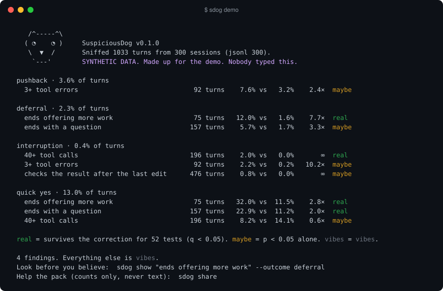

<p align="center">
  <picture>
    <source media="(prefers-color-scheme: dark)" srcset="assets/logo-dark.png">
    
  </picture>
</p>

<h1 align="center">SuspiciousDog</h1>

<p align="center"><b>He doesn't trust your plugins. He's read your transcripts.</b></p>

<p align="center">
  <a href="https://github.com/Saturday-Company/SuspiciousDog/actions/workflows/test.yml"></a>
  
  
  
  <a href="LICENSE"></a>
</p>

<p align="center"><a href="README.it.md">Italiano</a></p>

<p align="center">
  
</p>

Every plugin, skill, hook and line of `CLAUDE.md` or `AGENTS.md` you give an AI agent is a hypothesis:
*if the agent does X, my work goes better.* Nobody tests it. You install it because it sounds smart.

Your agent has been keeping notes the whole time. Every turn of every session is on disk, along with what you
said right after. That's the experiment, already run. SuspiciousDog reads it.

## You know him

Sits in the corner. Says nothing when you install the plugin everyone's posting about. Two weeks later he walks
over with a printout. It changed nothing. He was right. He's always right. He read the logs.

## The numbers

We pointed him at our own sessions first: 290 Claude Code sessions, 980 turns, 28 days. One developer, one model.
Real data, the same counts anyone can rebuild with `sdog sniff`. We handed him our three best ideas.

**Names written from memory. Dead.** When an agent writes a method, flag or column it never saw in the context, it
comes from the model's memory. That's where hallucinations live, surely. Of 90,101 names, the 19,244 written from
memory broke a tool call 0.07% of the time. The ones it had seen: 0.13%. The model's memory is fine. Our idea wasn't.

**"Done", without looking. Dead.** The agent says it's finished without running, rendering or opening anything
after its last edit. Happened in 27 turns. Pushback afterwards: 3.7%, against 3.1% everywhere else. Nothing.

**"Shall I also…?" Real.** The agent ends the turn offering more work. The answer is pushback 14.3% of the time,
against 2.6% (q = 0.045). `sdog show` explains it: it's not anger. It's *"no, put it on the list for later"*.
The same turns get a deferral 10.2% of the time against 1.4%, just short of the bar.

Two ideas out of three died in an evening. Without measuring, we'd have shipped both as hooks to every project
we have. The one that survived, survived by a whisker.

That's one developer. Effects that small need more than one developer to be sure. **That's where you come in.**

## Help the pack

```bash
sdog share
```

It prints everything it would send, and waits for your yes. Then it opens a GitHub issue under your account with
this, and only this:

| Sent | Never sent |
|---|---|
| which agents, how many sessions | your prompts, your agent's replies |
| how many turns, over how many days | file names, paths, project names |
| for each factor × outcome: four integers | code, commands, anything you typed |

The factor names come from SuspiciousDog's own list, and a test fails the build if anything else could get in
([PRIVACY.md](PRIVACY.md)). Every shared result is public, so the dataset belongs to everyone who adds to it. We'll
publish what it shows: which agent habits get pushed back on, on which agents, and whether the popular plugins
move anything at all.

## Ten seconds

```bash
pipx install git+https://github.com/Saturday-Company/SuspiciousDog
sdog demo        # synthetic sessions, to see what it looks like
sdog             # your own
```

<p align="center"></p>

The demo runs on made-up sessions with one planted effect, and says so. `real` means the result survives the
correction for every test he ran. `maybe` is a lead. `vibes` is vibes.

## Commands

| | |
|---|---|
| `sdog sniff` | every factor against every outcome (`--agent`, `--project`, `--outcome`, `--all`) |
| `sdog show "ends offering more work" --outcome deferral` | the actual turns behind a number. Read them before you believe anything. |
| `sdog test "t.tool_calls > 40"` | your own hypothesis, as a Python expression over a turn |
| `sdog before-after CLAUDE.md` | did that rule help? Compares outcomes before and after its last commit (or any date). |
| `sdog share` | counts to the public dataset, after you've seen them |
| `sdog provenance` | experiment 1 on a session: names on evidence, names from memory |
| `sdog agents` / `sdog format` | what he can read, and the open format for everything else |

## Install

**Any agent, any OS:** `pipx install git+https://github.com/Saturday-Company/SuspiciousDog`, then `sdog`.
Python 3.10+, no dependencies.

**Claude Code plugin** (adds `/suspiciousdog:sniff` and a skill, no pip needed):

```bash
claude plugin marketplace add Saturday-Company/SuspiciousDog
claude plugin install suspiciousdog@suspiciousdog
```

**Codex, Gemini CLI, Cursor, OpenCode and the rest:** install with pipx and copy [`AGENTS.md`](AGENTS.md) into
your project, or point the agent at [`skills/suspiciousdog/SKILL.md`](skills/suspiciousdog/SKILL.md). Details per
agent in [INSTALL.md](INSTALL.md).

## What he reads

| Agent | Where | Status |
|---|---|---|
| Claude Code | `~/.claude/projects/*/*.jsonl` | stable, tested on real sessions |
| Codex CLI | `~/.codex/sessions/**/rollout-*.jsonl` (legacy and paginated) | beta |
| Gemini CLI | `~/.gemini/tmp/*/chats/session-*.jsonl` (and the old `.json`) | beta |
| Aider | `.aider.chat.history.md` | beta |
| Anything else | the open JSONL format, `sdog format` | stable |

Beta readers are built from each agent's source code and tested on fixtures, not yet on real sessions. If one
misreads yours, open an issue with the shape (not the content) of the file.

## How it works

1. Sessions become **turns**: your message, everything the agent did, and your next message.
2. Each turn gets **factors** (it wrote files, used subagents, ended with an offer, claimed done without looking,
   ran 40+ tools…) and **outcomes** (your reply was pushback, a deferral, a quick yes, or you interrupted it).
3. For every factor and outcome: outcome rate with the factor vs without, Fisher's exact test, then
   Benjamini-Hochberg across all tests, because with 80 tests a few small p-values are just luck.
4. `show` puts the real turns next to every number. Outcomes are read from the text of your reply, so a "no" to an
   offer counts as pushback. The numbers say where to look; the turns say what happened.

## FAQ

**Is it causation?** No. He tells you where to look. You look.

**Does anything leave my machine?** Only when you run `sdog share` and say yes, and only counts.

**It found nothing.** Good. Your agent is fine, or you need more sessions. Either way, no new plugins today.

**My agent isn't listed.** Six kinds of JSON lines. `sdog format`.

**Can I add a factor?** `sdog test` takes any expression. If it's worth keeping, open a PR to `signals.py`.

**Why "SuspiciousDog"?** Look at him.

## License

MIT. Made by [Saturday Company](https://saturdaycompany.it). Our own counts are in [`results/`](results/) and the
methods in [RESULTS.md](RESULTS.md).
